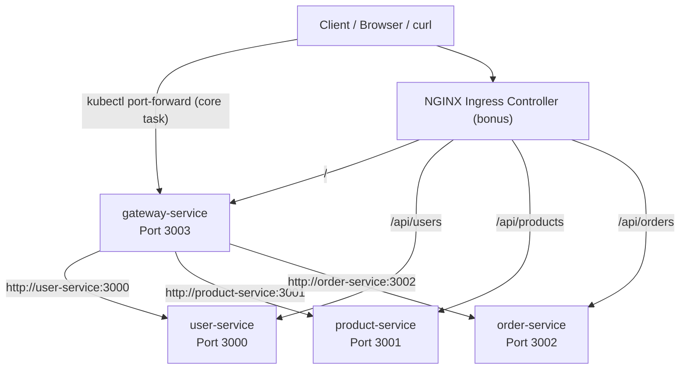
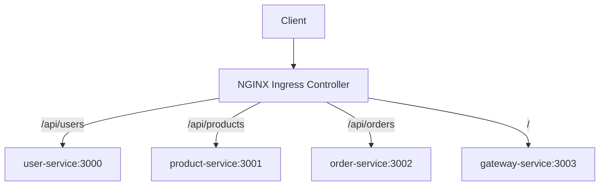

# Kubernetes Microservices Deployment on Minikube

A containerized Node.js microservices application deployed on a local Kubernetes cluster using **Docker, Minikube and kubectl**, with an optional **NGINX Ingress** bonus implementation.

---

## Table of Contents

1. [Project Overview](#1-project-overview)
2. [Technologies Used](#2-technologies-used)
3. [Architecture](#3-architecture)
4. [Repository Structure](#4-repository-structure)
5. [Microservices](#5-microservices)
6. [Prerequisites](#6-prerequisites)
7. [Step 1 – Build Docker Images](#7-step-1--build-docker-images)
8. [Step 2 – Minikube Setup](#8-step-2--minikube-setup)
9. [Step 3 – Kubernetes Deployments](#9-step-3--kubernetes-deployments)
10. [Step 4 – Kubernetes Services](#10-step-4--kubernetes-services)
11. [Step 5 – Deploy and Validate](#11-step-5--deploy-and-validate)
12. [Step 6 – Test Service Communication](#12-step-6--test-service-communication)
13. [Logs and Screenshots](#13-logs-and-screenshots)
14. [Bonus – Ingress Configuration](#14-bonus--ingress-configuration)
15. [Troubleshooting](#15-troubleshooting)
16. [Useful Commands](#16-useful-commands)
17. [Cleanup](#17-cleanup)
18. [Submission Packaging](#18-submission-packaging)
19. [Requirement Checklist](#19-requirement-checklist)
20. [Key Concepts (Learning Notes)](#20-key-concepts-learning-notes)
21. [Conclusion](#21-conclusion)

---

## 1. Project Overview

This project deploys four independent microservices on a local Kubernetes cluster:

| Service | Port | Responsibility |
|---|---:|---|
| **User Service** | 3000 | Returns user information |
| **Product Service** | 3001 | Returns product information |
| **Order Service** | 3002 | Creates and retrieves orders |
| **Gateway Service** | 3003 | Single API entry point; forwards requests to the other three services |

Kubernetes **Deployments** manage the Pods, **ClusterIP Services** provide internal networking and DNS-based service discovery, and an **NGINX Ingress Controller** (bonus) provides HTTP path-based routing.

### Objectives

- Build Docker images for all four microservices.
- Write Deployment manifests with image, resources, environment variables, probes, labels and selectors.
- Write ClusterIP Service manifests for cluster-level service discovery.
- Run everything on Minikube and validate inter-service communication.
- Document setup, deployment, testing and troubleshooting.
- (Bonus) Route `/api/users`, `/api/products`, `/api/orders` and `/` through NGINX Ingress.

Source application: <https://github.com/mohanDevOps-arch/Microservices-Task.git>

---

## 2. Technologies Used

| Technology | Purpose |
|---|---|
| Node.js 20 / Express.js | Application runtime and REST framework |
| Axios | HTTP calls from the Gateway to the other services |
| Docker / Docker Desktop | Containerization |
| Kubernetes | Container orchestration |
| Minikube (Docker driver) | Local single-node Kubernetes cluster |
| kubectl | Kubernetes CLI |
| NGINX Ingress Controller | HTTP routing (bonus) |
| curl | API testing |

---

## 3. Architecture



**Request flow**

1. In the core task, the client reaches the Gateway using `kubectl port-forward`.
2. The Gateway calls the other services using Kubernetes DNS names (`user-service`, `product-service`, `order-service`). Kubernetes resolves each name to the ClusterIP of the matching Service, which load-balances to the healthy Pods.
3. With Ingress enabled, the client can also reach each service directly by URL path.

---

## 4. Repository Structure

```text
.
├── deployments/
│   ├── user-service.yaml
│   ├── product-service.yaml
│   ├── order-service.yaml
│   └── gateway-service.yaml
├── services/
│   ├── user-service.yaml
│   ├── product-service.yaml
│   ├── order-service.yaml
│   └── gateway-service.yaml
├── ingress/                    # Bonus task
│   └── ingress.yaml
├── screenshots/
│   ├── pods.png
│   ├── logs.png
│   └── service-test.png
├── user-service/               # Application source + Dockerfile
├── product-service/
├── order-service/
├── gateway-service/
└── README.md
```

> The assessment requires the manifest files to be named `<service>-service.yaml` inside `deployments/` and `services/`. The two folders separate the resource kinds, so the same filename is used in both.

---

## 5. Microservices

All services expose a `/health` endpoint used by the Kubernetes probes.

| Service | Container port | Kubernetes Service name | Own endpoints | Gateway route |
|---|---:|---|---|---|
| User | 3000 | `user-service` | `/health`, `/users` | `/api/users` |
| Product | 3001 | `product-service` | `/health`, `/products` | `/api/products` |
| Order | 3002 | `order-service` | `/health`, `/orders` (GET, POST) | `/api/orders` |
| Gateway | 3003 | `gateway-service` | `/health` | – |

**Internal URLs used by the Gateway**

| Destination | URL |
|---|---|
| User Service | `http://user-service:3000/users` |
| Product Service | `http://product-service:3001/products` |
| Order Service | `http://order-service:3002/orders` |

> **Note:** The Order Service keeps data in memory. Orders are lost when the Pod restarts.

---

## 6. Prerequisites

Verify the tools are installed:

```bash
docker --version
kubectl version --client
minikube version
```

Docker Desktop (or another Docker engine) must be **running**:

```bash
docker info
```

---

## 7. Step 1 – Build Docker Images

### Dockerfile (same pattern for every service; only `EXPOSE` changes)

```dockerfile
FROM node:20-alpine

WORKDIR /app

COPY package*.json ./
RUN npm install --omit=dev

COPY app.js ./

EXPOSE 3000

CMD ["node", "app.js"]
```

Why this layout: copying `package*.json` first lets Docker cache the dependency layer, so rebuilds are fast when only `app.js` changes.

### Build the images

From the repository root:

```bash
docker build -t user-service:1.0    ./user-service
docker build -t product-service:1.0 ./product-service
docker build -t order-service:1.0   ./order-service
docker build -t gateway-service:1.0 ./gateway-service
```

Verify:

```bash
docker images | grep -E "user-service|product-service|order-service|gateway-service"
```

---

## 8. Step 2 – Minikube Setup

### 8.1 Start the cluster

```bash
minikube start --driver=docker
```

### 8.2 Verify the cluster

```bash
minikube status
kubectl get nodes
```

Expected: `host`, `kubelet` and `apiserver` are `Running`, and the node shows `Ready`.

### 8.3 Load the local images into Minikube

Minikube runs its own container runtime, so images built on the host are not visible to it automatically. Load each image:

```bash
minikube image load user-service:1.0
minikube image load product-service:1.0
minikube image load order-service:1.0
minikube image load gateway-service:1.0
```

Confirm:

```bash
minikube image ls | grep -E "service:1.0"
```

> Because the images exist only locally (no registry), every Deployment uses `imagePullPolicy: IfNotPresent`. With the default policy for a `:latest` tag, Kubernetes would try to pull from a registry and fail with `ImagePullBackOff`.

---

## 9. Step 3 – Kubernetes Deployments

Each Deployment in `deployments/` includes everything the assessment requires:

| Requirement | How it is met |
|---|---|
| Correct image reference | `image: <service>:1.0` with `imagePullPolicy: IfNotPresent` |
| Resource requests and limits | CPU `100m` / `500m`, memory `64Mi` / `128Mi` |
| Environment variables | `PORT`, `NODE_ENV`, and (Gateway) the upstream service URLs |
| Liveness probe | `httpGet /health` on the service port |
| Readiness probe | `httpGet /health` on the service port |
| Labels and selectors | `app: <service-name>` on the Pod template, matched by `spec.selector.matchLabels` |

### Example – `deployments/user-service.yaml`

```yaml
apiVersion: apps/v1
kind: Deployment
metadata:
  name: user-service
  labels:
    app: user-service
spec:
  replicas: 1
  selector:
    matchLabels:
      app: user-service
  template:
    metadata:
      labels:
        app: user-service
    spec:
      containers:
        - name: user-service
          image: user-service:1.0
          imagePullPolicy: IfNotPresent
          ports:
            - containerPort: 3000
          env:
            - name: PORT
              value: "3000"
            - name: NODE_ENV
              value: "production"
          resources:
            requests:
              cpu: 100m
              memory: 64Mi
            limits:
              cpu: 500m
              memory: 128Mi
          livenessProbe:
            httpGet:
              path: /health
              port: 3000
            initialDelaySeconds: 10
            periodSeconds: 10
          readinessProbe:
            httpGet:
              path: /health
              port: 3000
            initialDelaySeconds: 5
            periodSeconds: 5
```

The Product (3001) and Order (3002) manifests follow the same pattern with their own name, label, image and port.

### Gateway-specific configuration

The Gateway also receives the addresses of the upstream services through environment variables. The names below must match what `gateway-service/app.js` reads; if the application hard-codes the URLs, these variables are still useful as documented configuration.

```yaml
          env:
            - name: PORT
              value: "3003"
            - name: NODE_ENV
              value: "production"
            - name: USER_SERVICE_URL
              value: "http://user-service:3000"
            - name: PRODUCT_SERVICE_URL
              value: "http://product-service:3001"
            - name: ORDER_SERVICE_URL
              value: "http://order-service:3002"
```

### Apply and verify

```bash
kubectl apply -f deployments/
kubectl get deployments
kubectl rollout status deployment/user-service
kubectl rollout status deployment/product-service
kubectl rollout status deployment/order-service
kubectl rollout status deployment/gateway-service
```

---

## 10. Step 4 – Kubernetes Services

All four Services are of type **ClusterIP**, which gives each one a stable internal IP and a DNS name that only resolves inside the cluster.

| Service | Port | Target port | Type |
|---|---:|---:|---|
| user-service | 3000 | 3000 | ClusterIP |
| product-service | 3001 | 3001 | ClusterIP |
| order-service | 3002 | 3002 | ClusterIP |
| gateway-service | 3003 | 3003 | ClusterIP |

### Example – `services/user-service.yaml`

```yaml
apiVersion: v1
kind: Service
metadata:
  name: user-service
  labels:
    app: user-service
spec:
  type: ClusterIP
  selector:
    app: user-service      # must match the Pod labels in the Deployment
  ports:
    - name: http
      port: 3000           # port exposed by the Service
      targetPort: 3000     # containerPort of the Pod
```

### Apply and verify

```bash
kubectl apply -f services/
kubectl get services
kubectl get endpoints
```

`kubectl get endpoints` should list a Pod IP for every Service. An empty endpoint list means the selector does not match any ready Pod.

---

## 11. Step 5 – Deploy and Validate

Apply everything (Deployments first, then Services):

```bash
kubectl apply -f deployments/
kubectl apply -f services/
```

Check the Pods:

```bash
kubectl get pods
kubectl get pods -o wide
```

**Expected:** four Pods in `Running` state with `1/1` containers ready.

Check all resources at once:

```bash
kubectl get all
```

---

## 12. Step 6 – Test Service Communication

The Gateway is ClusterIP-only, so it is reachable from the host through `kubectl port-forward`.

### 12.1 Port-forward the Gateway

Run in a **separate terminal** and keep it open:

```bash
kubectl port-forward service/gateway-service 3003:3003
```

Expected output:

```text
Forwarding from 127.0.0.1:3003 -> 3003
Forwarding from [::1]:3003 -> 3003
```

### 12.2 Run the tests

```bash
# Gateway health
curl http://localhost:3003/health

# Users, products and orders through the Gateway
curl http://localhost:3003/api/users
curl http://localhost:3003/api/products
curl http://localhost:3003/api/orders

# Create an order (POST)
curl -X POST http://localhost:3003/api/orders \
  -H "Content-Type: application/json" \
  -d '{"userId":1,"productId":1}'

# Confirm the new order is returned
curl http://localhost:3003/api/orders
```

### 12.3 Test summary

| Test | Command | Expected result |
|---|---|---|
| Gateway health | `GET /health` | `{"status":"Gateway Service is healthy"}` |
| User API | `GET /api/users` | List of users (John Doe, Jane Smith) |
| Product API | `GET /api/products` | List of products (Laptop – $999, Phone – $699) |
| Order API | `GET /api/orders` | List of orders (may be empty initially) |
| Create order | `POST /api/orders` | New order with ID, user ID, product ID, timestamp |
| Verify order | `GET /api/orders` | Created order appears in the list |

A successful response from `/api/users`, `/api/products` and `/api/orders` proves the Gateway reached the other three Pods through their Kubernetes Service DNS names.

### 12.4 Alternative: test using service names from inside the cluster

This removes the host from the picture and tests pure cluster DNS:

```bash
kubectl run curl-test --rm -it --image=curlimages/curl --restart=Never -- \
  curl -s http://gateway-service:3003/api/users
```

Or from inside the Gateway Pod (if `wget`/`curl` exists in the image):

```bash
kubectl exec deploy/gateway-service -- wget -qO- http://user-service:3000/health
```

---

## 13. Logs and Screenshots

### 13.1 View logs

```bash
kubectl logs deployment/gateway-service
kubectl logs -l app=user-service
kubectl logs -l app=product-service
kubectl logs -l app=order-service
kubectl logs -l app=gateway-service
```

To follow the logs live while sending requests:

```bash
kubectl logs -f deployment/gateway-service
```

### 13.2 Screenshots

| File | What it shows | Command to capture |
|---|---|---|
| `screenshots/pods.png` | All four Pods `Running` and `1/1` ready | `kubectl get pods -o wide` |
| `screenshots/logs.png` | Startup and request logs showing service communication | Logs commands above, captured after sending curl requests |
| `screenshots/service-test.png` | Port-forward running and successful curl results | `kubectl port-forward ...` plus the curl tests |

#### Running Pods


#### Logs showing service communication


#### Port-forwarded test results


> **Tip for `logs.png`:** send a few curl requests *first*, then run the logs commands, so the screenshot shows real request activity and not only the "server started" line.

---

## 14. Bonus – Ingress Configuration

### 14.1 Enable the Ingress controller

```bash
minikube addons enable ingress
kubectl get pods -n ingress-nginx
```

Wait until the `ingress-nginx-controller` Pod is `Running`.

### 14.2 Routing rules

| URL path | Backend Service | Port |
|---|---|---:|
| `/api/users` | user-service | 3000 |
| `/api/products` | product-service | 3001 |
| `/api/orders` | order-service | 3002 |
| `/` | gateway-service | 3003 |

The public paths (`/api/users`, …) differ from the backend endpoints (`/users`, …), so the User, Product and Order routes use the `nginx.ingress.kubernetes.io/rewrite-target` annotation. Because the rewrite annotation applies to **every path in the same Ingress resource**, each rewritten route lives in its own Ingress, and the Gateway (`/`, no rewrite) has its own as well.

### 14.3 Example – `ingress/ingress.yaml`

```yaml
apiVersion: networking.k8s.io/v1
kind: Ingress
metadata:
  name: user-ingress
  annotations:
    nginx.ingress.kubernetes.io/use-regex: "true"
    nginx.ingress.kubernetes.io/rewrite-target: /users/$2
spec:
  ingressClassName: nginx
  rules:
    - host: microservices.local          # host-based rule
      http:
        paths:
          - path: /api/users(/|$)(.*)
            pathType: ImplementationSpecific
            backend:
              service:
                name: user-service
                port:
                  number: 3000
---
apiVersion: networking.k8s.io/v1
kind: Ingress
metadata:
  name: product-ingress
  annotations:
    nginx.ingress.kubernetes.io/use-regex: "true"
    nginx.ingress.kubernetes.io/rewrite-target: /products/$2
spec:
  ingressClassName: nginx
  rules:
    - host: microservices.local
      http:
        paths:
          - path: /api/products(/|$)(.*)
            pathType: ImplementationSpecific
            backend:
              service:
                name: product-service
                port:
                  number: 3001
---
apiVersion: networking.k8s.io/v1
kind: Ingress
metadata:
  name: order-ingress
  annotations:
    nginx.ingress.kubernetes.io/use-regex: "true"
    nginx.ingress.kubernetes.io/rewrite-target: /orders/$2
spec:
  ingressClassName: nginx
  rules:
    - host: microservices.local
      http:
        paths:
          - path: /api/orders(/|$)(.*)
            pathType: ImplementationSpecific
            backend:
              service:
                name: order-service
                port:
                  number: 3002
---
apiVersion: networking.k8s.io/v1
kind: Ingress
metadata:
  name: gateway-ingress
spec:
  ingressClassName: nginx
  rules:
    - host: microservices.local
      http:
        paths:
          - path: /
            pathType: Prefix
            backend:
              service:
                name: gateway-service
                port:
                  number: 3003
```

> **Host rule:** the assessment asks for host-based rules and path mapping. The example uses `microservices.local`. If your own manifest uses a wildcard (no `host:`), every request matches regardless of the `Host` header; both approaches work, but a named host requires the `Host` header (see testing below).

### 14.4 Apply and verify

```bash
kubectl apply -f ingress/
kubectl get ingress
```

Expected resources: `user-ingress`, `product-ingress`, `order-ingress`, `gateway-ingress`.

### 14.5 Access the Ingress (Docker driver on macOS)

With the Docker driver on macOS, the Minikube node IP is not directly reachable from the host. Use one of these:

**Option A – tunnel (keep this terminal open)**

```bash
minikube tunnel
```

Then send requests to `127.0.0.1` on port 80.

**Option B – service URL (keep this terminal open)**

```bash
minikube service ingress-nginx-controller -n ingress-nginx --url
```

This prints a local URL such as `http://127.0.0.1:<random-port>`. The port changes on every run, so always use the value printed by your own command.

### 14.6 Test the routes

Replace `<URL>` with the address from the previous step. If you used a named host, pass it in the `Host` header:

```bash
curl -H "Host: microservices.local" <URL>/api/users
curl -H "Host: microservices.local" <URL>/api/products
curl -H "Host: microservices.local" <URL>/api/orders
curl -H "Host: microservices.local" <URL>/health
```

If your Ingress has no `host:` rule, omit the `-H "Host: ..."` part.

### 14.7 Ingress architecture



---

## 15. Troubleshooting

| Problem | Diagnose | Fix |
|---|---|---|
| **Minikube not running** | `minikube status` | Start Docker Desktop, then `minikube start --driver=docker` |
| **Pods not starting** | `kubectl get pods`, `kubectl describe pod <pod>`, `kubectl logs <pod>` | Check image name, startup errors and failed probes in the `Events` section |
| **`ImagePullBackOff` / `ErrImagePull`** | `kubectl describe pod <pod>` | Confirm the image name/tag, run `minikube image load <image>:1.0`, and make sure `imagePullPolicy: IfNotPresent` |
| **`CrashLoopBackOff`** | `kubectl logs <pod> --previous` | Fix the application error; verify `PORT` and the start command |
| **Pod `Running` but `0/1` ready** | `kubectl describe pod <pod>` | The readiness probe is failing: verify the `/health` path and probe port |
| **Service unreachable** | `kubectl get endpoints` | Empty endpoints → Service `selector` does not match Pod labels, or the Pod is not ready; also check `targetPort` |
| **Port-forward fails** | `lsof -i :3003` | Free the port or forward to another local port: `kubectl port-forward service/gateway-service 3004:3003` |
| **Gateway cannot reach another service** | `kubectl logs deployment/gateway-service` | Verify Service names, ports and the URLs used by the Gateway |
| **Changes to code not visible** | – | Rebuild with a **new tag** (e.g. `1.1`), reload with `minikube image load`, update the manifest and re-apply. Reusing the same tag with `IfNotPresent` keeps the old image |
| **Ingress returns 404** | `kubectl get ingress`, `kubectl describe ingress <name>` | Check the `Host` header, path regex and rewrite-target |
| **Ingress not reachable** | `minikube addons list`, `kubectl get pods -n ingress-nginx` | Ensure the addon is enabled and `minikube tunnel` (or the `--url` command) is still running |
| **Ingress admission webhook error on apply** | Re-run apply after 30–60 s | The controller was not ready yet; wait for the controller Pod to be `Running` |

General debugging order: **Pods → describe → logs → endpoints → Service → Ingress.**

---

## 16. Useful Commands

| Command | Purpose |
|---|---|
| `minikube status` | Cluster status |
| `kubectl get nodes` | List nodes |
| `kubectl get pods -o wide` | Pods with IP and node |
| `kubectl get deployments` | List Deployments |
| `kubectl get services` | List Services |
| `kubectl get endpoints` | Pod IPs behind each Service |
| `kubectl get ingress` | List Ingress resources |
| `kubectl describe pod <pod>` | Detailed Pod info and events |
| `kubectl logs <pod>` | Pod logs |
| `kubectl logs -l app=<name>` | Logs by label |
| `kubectl rollout status deployment/<name>` | Wait for rollout |
| `kubectl rollout restart deployment/<name>` | Restart a Deployment |
| `kubectl exec -it <pod> -- sh` | Shell inside a Pod |
| `kubectl port-forward service/gateway-service 3003:3003` | Expose the Gateway locally |
| `kubectl delete -f <folder>/` | Delete resources defined in a folder |

---

## 17. Cleanup

```bash
kubectl delete -f ingress/
kubectl delete -f services/
kubectl delete -f deployments/

minikube stop      # stop the cluster, keep it for later
minikube delete    # remove the cluster completely
```

> Do **not** run `minikube delete` before all screenshots are captured and the demo is complete.

---

## 18. Submission Packaging

The assessment expects a `submission.zip` containing a `submission/` folder:

```text
submission/
├── deployments/   (user-service.yaml, product-service.yaml, order-service.yaml, gateway-service.yaml)
├── services/      (user-service.yaml, product-service.yaml, order-service.yaml, gateway-service.yaml)
├── ingress/       (ingress.yaml)          # bonus
├── screenshots/   (pods.png, logs.png, service-test.png)
└── README.md
```

Create the archive:

```bash
mkdir submission
cp -r deployments services ingress screenshots README.md submission/
zip -r submission.zip submission -x "*.DS_Store"
unzip -l submission.zip      # verify the structure
```

---

## 19. Requirement Checklist

### Basic Kubernetes Deployment (30 marks)

- [x] Deployment manifests for User, Product, Order and Gateway services (18)
  - [x] Correct container image reference
  - [x] Resource requests and limits
  - [x] Environment variables
  - [x] Liveness and readiness probes
  - [x] Proper labels and selectors
- [x] Service manifests with correct ports and ClusterIP type (12)

### Minikube Setup and Validation (15 marks)

- [x] Minikube initialized and verified
- [x] All components deployed; Pods `Running` and ready
- [x] Inter-service communication validated with curl and logs

### Documentation and Testing (5 marks)

- [x] README with setup, `kubectl apply -f`, testing and troubleshooting
- [ ] `screenshots/pods.png`
- [ ] `screenshots/logs.png`
- [ ] `screenshots/service-test.png`

### Bonus

- [x] Ingress controller enabled
- [x] Ingress resources with path routing for `/api/users`, `/api/products`, `/api/orders`, `/`
- [x] Routes tested successfully

---

## 20. Key Concepts (Learning Notes)

**Deployment vs Pod.** A Pod is one running instance. A Deployment declares the desired state (image, replicas, probes) and keeps it true: it recreates failed Pods and performs rolling updates.

**Labels and selectors.** Labels are key/value tags. A Deployment's `selector.matchLabels` must match its Pod template labels, and a Service's `selector` must match the Pod labels. A mismatch is the most common reason a Service has no endpoints.

**`port` vs `targetPort` vs `containerPort`.**

- `containerPort`: the port the application listens on inside the container.
- `targetPort`: the Pod port a Service forwards traffic to (must equal the app's port).
- `port`: the port the Service itself exposes inside the cluster.

**ClusterIP and service discovery.** A ClusterIP Service gets a virtual IP and a DNS name (`<service>.<namespace>.svc.cluster.local`, shortened to `<service>` within the same namespace). This is why the Gateway can call `http://user-service:3000` without knowing any Pod IP.

**Liveness vs readiness.** Liveness answers "should this container be restarted?". Readiness answers "should this Pod receive traffic?". A failing readiness probe removes the Pod from the Service endpoints without restarting it.

**Requests vs limits.** Requests are what the scheduler reserves for the Pod; limits are the maximum it may use. Exceeding the memory limit gets the container OOM-killed; exceeding the CPU limit throttles it.

**`imagePullPolicy: IfNotPresent`.** Required here because images are loaded directly into Minikube and not pushed to a registry.

**`port-forward` vs Ingress.** `port-forward` is a temporary, per-developer tunnel to one Service, ideal for testing. Ingress is a cluster-level HTTP router that maps hosts and paths to Services.

**Why separate Ingress resources.** `rewrite-target` is an annotation on the whole Ingress. Routes that need different rewrites must therefore be in different Ingress objects.

---

## 21. Conclusion

This project packages four Node.js microservices as Docker images and deploys them on Minikube using Kubernetes Deployments and ClusterIP Services. Health probes, resource requests/limits, environment variables and label selectors are configured for every workload. The Gateway communicates with the User, Product and Order services through Kubernetes service discovery, which was validated with HTTP GET and POST requests and application logs. The optional NGINX Ingress task adds path-based routing for `/api/users`, `/api/products`, `/api/orders` and `/`.
